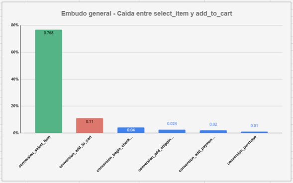
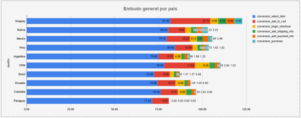
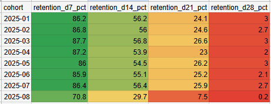
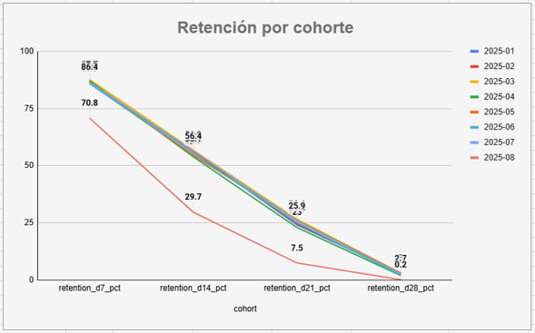

# Análisis de embudo de conversión y retención de usuarios – MercadoLibre

## Descripción del proyecto

Este proyecto tiene como objetivo analizar el comportamiento de los usuarios de MercadoLibre mediante consultas SQL, identificando oportunidades de mejora en el proceso de conversión y en la retención de clientes.

A través del análisis del embudo de conversión, la segmentación por país y el análisis de retención por cohortes, se identifican puntos de abandono y patrones de comportamiento que pueden aportar información útil para la toma de decisiones del negocio.

## Objetivos

- Analizar el recorrido de los usuarios desde su primera visita hasta la compra.
- Identificar las etapas del embudo con mayores pérdidas de usuarios.
- Comparar el comportamiento de conversión entre países.
- Medir la retención de usuarios en los periodos D7, D14, D21 y D28.
- Analizar la retención según el mes de registro de los usuarios (cohortes).

## Herramientas utilizadas

- **SQL:** consultas y análisis de datos.
- **PostgreSQL:** gestión y consulta de las tablas.
- **GitHub:** documentación y publicación del proyecto.

## Datos utilizados

El análisis se realizó a partir de dos tablas:

| Tabla | Descripción |
|---|---|
| `mercadolibre_funnel` | Información de los eventos realizados por los usuarios durante su recorrido en la plataforma. |
| `mercadolibre_retention` | Información sobre el registro, actividad y comportamiento de retención de los usuarios. |

**Periodo analizado:** del 1 de enero al 31 de agosto de 2025.

El análisis de conversión contempla eventos como primera visita, selección de producto, incorporación al carrito, inicio del proceso de compra y compra finalizada.

## Etapas del análisis

### 1. Exploración de datos

- Inspección de las tablas disponibles.
- Identificación de eventos y usuarios.
- Reconocimiento de la estructura de los datos.

### 2. Análisis del embudo general de conversión

- Identificación de usuarios únicos por etapa.
- Cálculo de conversiones acumuladas desde la primera visita.
- Identificación de puntos de abandono durante el proceso de compra.

### 3. Análisis del embudo por país

- Segmentación de usuarios según país.
- Comparación de las tasas de conversión.
- Identificación de diferencias en el comportamiento de compra entre países.

### 4. Análisis de retención por país

- Conteo de usuarios activos acumulados en D7, D14, D21 y D28.
- Cálculo de porcentajes de retención por país.

### 5. Análisis de retención por cohortes

- Clasificación de usuarios según su mes de registro.
- Cálculo de la retención acumulada en D7, D14, D21 y D28.
- Comparación del comportamiento de las cohortes a lo largo del tiempo.

## Visualización de resultados

### 1. Embudo general de conversión

Este gráfico muestra el comportamiento de los usuarios a través de las diferentes etapas del proceso de compra e identifica los principales puntos de abandono.



### 2. Embudo de conversión por país

Comparación del comportamiento de conversión de los usuarios entre los diferentes países analizados.



### 3. Retención por país

Mapa de calor que permite comparar los porcentajes de retención acumulada de los usuarios por país en los periodos D7, D14, D21 y D28.



### 4. Retención por cohortes

Visualización de la evolución de la retención acumulada según el mes de registro de los usuarios, considerando los periodos D7, D14, D21 y D28.



## Principales resultados

- Se identificó una pérdida del **85,68 % de los usuarios entre la selección del producto y la incorporación al carrito**, lo que evidencia una oportunidad de mejora en esa etapa del recorrido.
- La conversión final de visita a compra fue del **1,25 %**, mostrando que una proporción reducida de los usuarios iniciales completó una compra.
- El análisis permitió comparar el comportamiento de conversión entre **10 países**.
- En el análisis de cohortes de enero a mayo, los promedios de retención reportados fueron:

| Periodo | Retención promedio |
|---|---:|
| D7 | 86,78 % |
| D14 | 55,48 % |
| D21 | 24,90 % |
| D28 | 2,74 % |

## Conclusiones y oportunidades de mejora

1. **Optimización del proceso de compra:** revisar la experiencia de selección de productos y los elementos que pueden estar dificultando que los usuarios agreguen productos al carrito.

2. **Análisis por país:** profundizar en las diferencias de conversión para identificar oportunidades de mejora específicas en cada mercado.

3. **Estrategias de retención:** fortalecer las acciones de seguimiento y fidelización, especialmente para reducir la pérdida de usuarios a medida que transcurre el tiempo desde su registro.

4. **Seguimiento por cohortes:** utilizar este análisis para evaluar si las estrategias implementadas generan mejoras en la permanencia y actividad de los usuarios.

## Estructura del repositorio

La organización de los archivos del proyecto es la siguiente:

```text
analisis-embudo-retencion-mercadolibre/
│
├── Imágenes/
│   ├── embudo_conversion_pais.png
│   ├── embudo_general.png
│   ├── retencion_cohortes.png
│   └── retencion_pais.png
│
├── SQL/
│   ├── 01_exploracion_datos.sql
│   ├── 02_embudo_conversion_general.sql
│   ├── 03_embudo_conversion_por_pais.sql
│   ├── 04_retencion_por_pais.sql
│   ├── 05_retencion_por_cohortes.sql
│   └── Código SQL
│
└── README.md
```

## Reproducibilidad y disponibilidad de los datos

Este proyecto fue desarrollado como parte de un ejercicio académico de análisis de datos en TripleTen.

Las consultas SQL se encuentran disponibles en este repositorio y documentan los procedimientos utilizados para explorar los datos, analizar el embudo de conversión y evaluar la retención de usuarios.

**Nota sobre los datos:** los archivos originales utilizados (`mercadolibre_funnel` y `mercadolibre_retention`) no se incluyen en este repositorio. Por esta razón, para ejecutar las consultas es necesario contar previamente con las tablas y sus respectivos datos en una base de datos PostgreSQL.

Los resultados y conclusiones presentados corresponden al análisis realizado durante el desarrollo del proyecto académico.

## Aprendizajes

Este proyecto permitió fortalecer habilidades en SQL y análisis de datos, especialmente en el uso de:

- CTE (Common Table Expressions).
- `JOIN` y `LEFT JOIN`.
- Funciones de agregación.
- `COUNT` y `DISTINCT`.
- Funciones de fecha.
- Cálculos porcentuales y funciones como `ROUND()` y `NULLIF()`.
- Análisis de conversión y retención por segmentos y cohortes.

También permitió comprender cómo transformar datos de comportamiento de usuarios en indicadores que ayudan a identificar oportunidades de mejora en conversión y retención.
